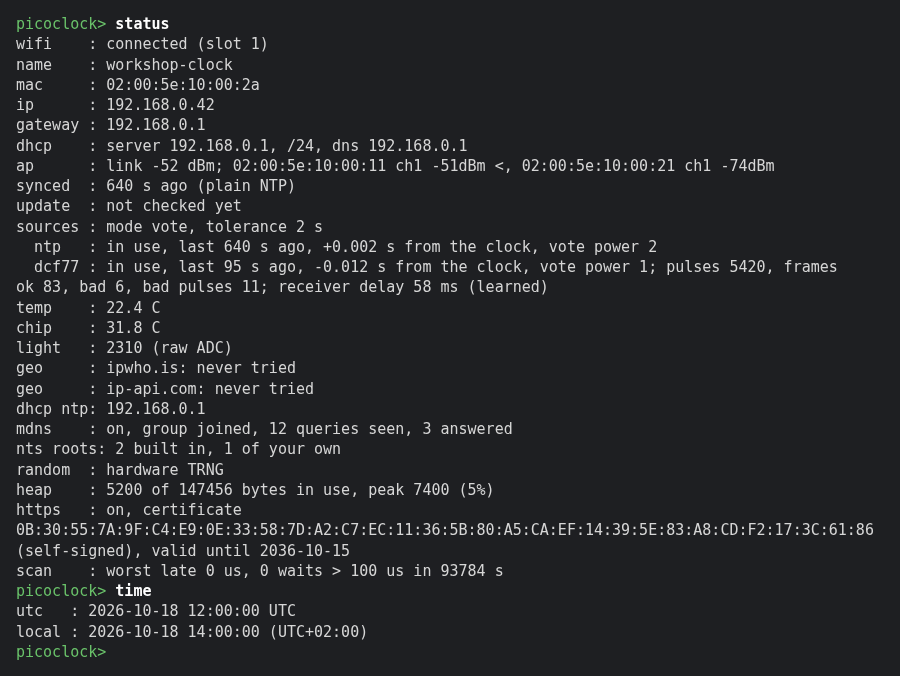
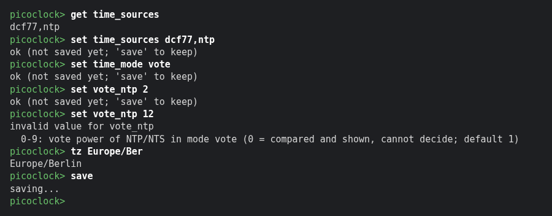
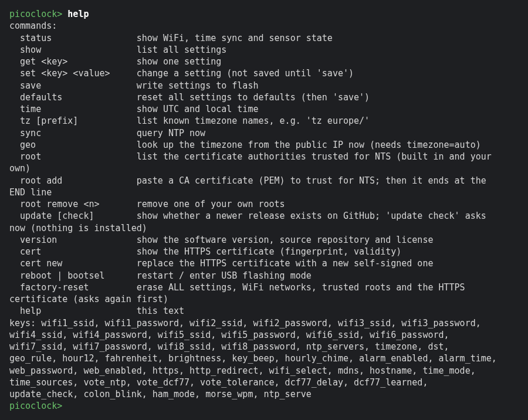
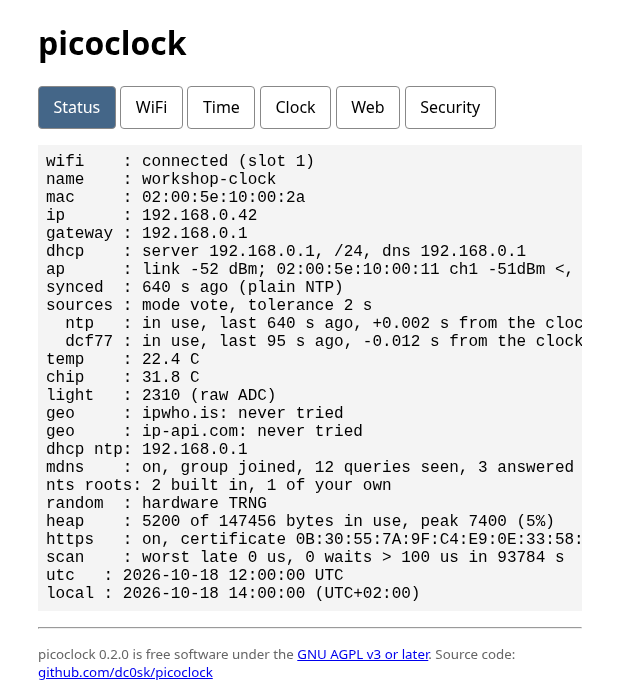
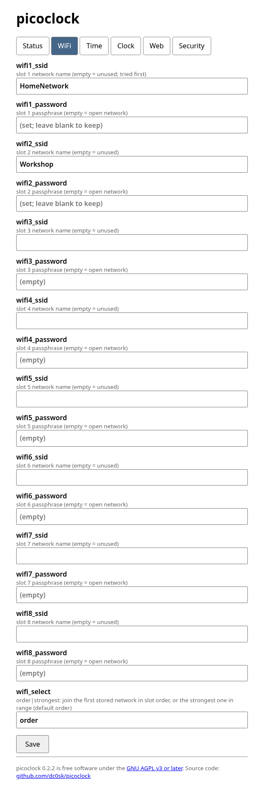
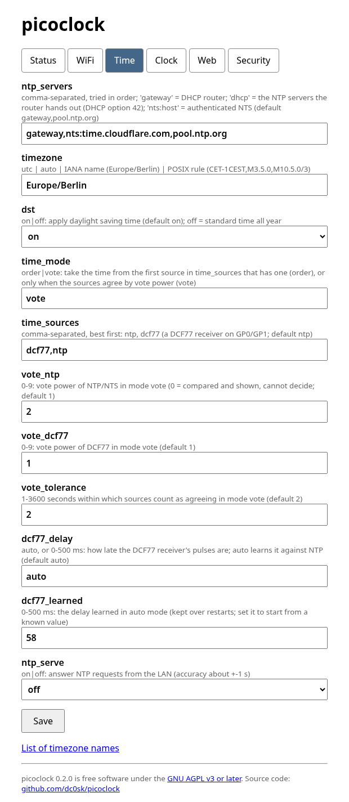
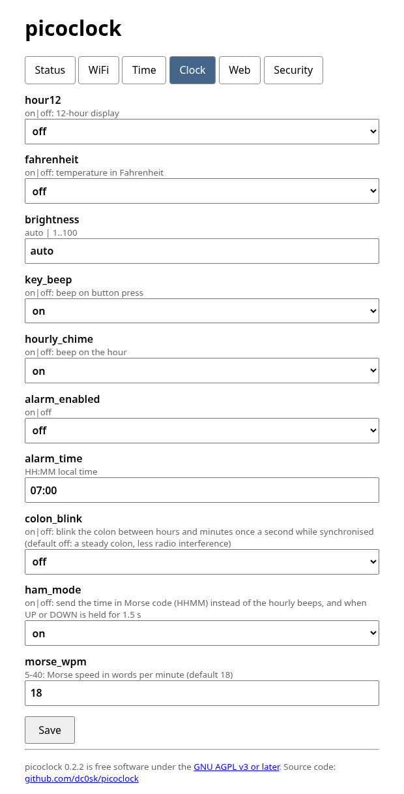
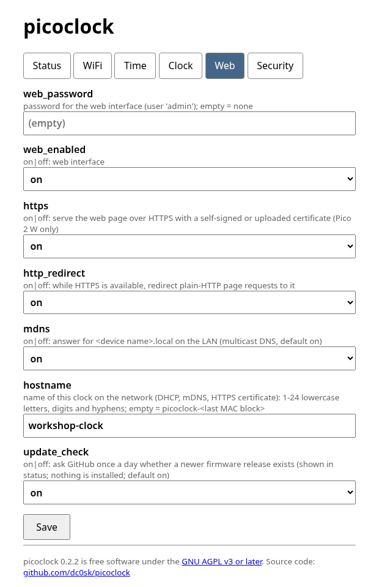
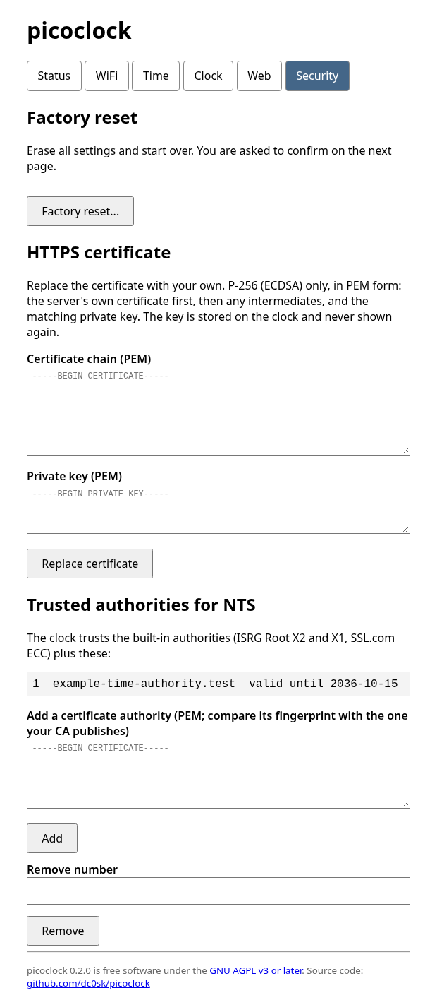

# picoclock

Rust firmware for the Waveshare [Pico-Clock-Green](https://www.waveshare.com/wiki/Pico-Clock-Green) with WiFi, NTP,
a USB terminal, a web configuration page and full use of the clock's hardware. Built on [Embassy](https://embassy.dev).

**Requires a Raspberry Pi Pico W** (RP2040) **or Pico 2 W** (RP2350), both with the CYW43439 radio, in the clock.
A plain Pico or Pico 2 has no WiFi. Both have run in the clock; the Pico W has had far more use (see *Status*).

| | Pico W (RP2040) | Pico 2 W (RP2350) |
|---|---|---|
| Web page | plain HTTP only | **HTTPS** (TLS 1.3), plain HTTP only redirects to it |
| Random numbers | ring-oscillator jitter (no hardware generator) | hardware TRNG |
| NTS key exchange | about 5 to 7 s once per boot | about 1 s |
| NTS servers with **RSA** certificates (Netnod, PTB, NIC.br, ...) | **not supported** | supported |
| NTS trust anchors you add | USB terminal only | USB terminal and the HTTPS page |

**HTTPS is available only on the Pico 2 W.** The TLS server library (`rustls`) does not build for the RP2040, so a Pico W
serves the web page, the web password and the WiFi passphrases over plain HTTP. If that matters, use a Pico 2 W, set a
`web_password`, or `set web_enabled off`. See *HTTPS (Pico 2 W)* below.

## Features

- **Time:** the DS3231 RTC always holds **UTC**. Local time is computed at display time from the configured
  timezone, including daylight saving, so DST changes need no sync. `timezone=utc` shows UTC directly.
- **Timezone:** `utc`, an IANA name (`Europe/Berlin`, 486 built in), a POSIX TZ rule
  (`CET-1CEST,M3.5.0,M10.5.0/3`), or `auto` to look it up from your public IP.
- **NTP client:** servers tried in order, default `gateway,pool.ntp.org` (`gateway` = your DHCP router). Hourly
  resync; the RTC is set exactly on a UTC second boundary, so the displayed seconds match real time.
- **Secure NTP (NTS, RFC 8915):** an `nts:<host>` entry in `ntp_servers` (for example `nts:time.cloudflare.com`)
  authenticates the time with TLS 1.3 and AES-SIV; see *Secure NTP* below.
- **Time sources:** NTP/NTS and, since 0.2.0, a DCF77 radio receiver module, combined by an ordered list with
  fallbacks or by a vote between them; see *Time sources*.
- **HAM mode (optional):** `set ham_mode on` makes the hourly chime the time in Morse code (HHMM, local 24-hour time), and holding
  UP or DOWN for 1.5 seconds sends it on request. SET keeps the menu. Speed `morse_wpm`, default 18.
- **NTP server (optional):** `ntp_serve on` lets other devices on the LAN use the clock as a time source. Off by default.
- **WiFi:** up to 8 stored networks, tried in slot order, or with `set wifi_select strongest` the strongest one in range
  first (stored networks the scan did not see, such as hidden ones, still get their turn). The device name on the network is
  `picoclock-<last MAC octet>`, and the clock answers mDNS for `picoclock-<xx>.local` (`set mdns off` to stop).
- **Configuration** in three ways, all validated by the same code and stored in flash:
  USB serial terminal, web page (HTTPS on the Pico 2 W, plain HTTP on the Pico W), and the buttons for the everyday settings.
- **Hardware:** RTC with its temperature sensor plus the RP2040/RP2350 die sensor (`chip` in `status`; it reads warmer
  than the room), buzzer (key beep, hourly chime, alarm), ambient-light auto-brightness, and the three buttons.

## Hardware

| Part                      | Product                                                                                                  | Notes |
|---------------------------|----------------------------------------------------------------------------------------------------------|-------|
| Clock                     | [Waveshare Pico-Clock-Green](https://www.waveshare.com/pico-clock-green.htm)                              | 32x8 LED matrix, DS3231 RTC, buzzer, light sensor, three buttons; takes a Raspberry Pi Pico on its header |
| Controller (**preferred**) | Raspberry Pi **Pico 2 W** (RP2350)                                                                       | All features: HTTPS, NTS with RSA certificate chains, hardware random number generator |
| Controller (alternative)  | Raspberry Pi **Pico W** (RP2040)                                                                          | Works, with the limits below |
| DCF77 receiver (optional) | [Pollin DCF1, order no. 810 054](https://www.pollin.de/p/dcf-empfangsmodul-dcf1-810054)                   | Pins PON, TCO, GND, VCC; wiring in *Time sources* |
| GPS (planned, not yet supported) | SparkFun u-blox NEO-M9N                                                                            | Next release cycle |
| Debug probe (optional)    | Raspberry Pi Debug Probe (CMSIS-DAP)                                                                      | Only for the RTT logs, see *Debugging* |

**What the Pico W (RP2040) cannot do compared with the Pico 2 W:** no HTTPS (the web page is plain HTTP, so the web password
and WiFi passphrases travel in clear on your LAN; use the USB terminal for those); NTS only with ECDSA certificate chains,
so servers with RSA chains (several Let's Encrypt-based ones, for example `ptbtime1.ptb.de`, and chains you add yourself) are
refused; random numbers come from the ring oscillator, conditioned in software, not from a hardware generator (this feeds
the NTS key exchange); and the NTS key exchange stops the other tasks for 5 to 7 seconds (0.5 to 1 second on the Pico 2 W).
The Pico W build has so far been compiled but not run with the features added since 0.1.0 (see *Status and limits*).

## Build and flash

Since the bootloader (ADR-0006) the flash holds a bootloader, a state sector, the running image and a slot for a staged image; the
settings stay in the last sectors. **A clock that still runs a version without the bootloader (0.2.0 and older) needs the combined
image once**; after that the bootloader stays. `tools/combine_image.py` joins the bootloader, an erased state sector and the
application into one UF2 (the state sector must be erased, or old program bytes in it could look like a swap order):

```sh
rustup target add thumbv6m-none-eabi thumbv8m.main-none-eabihf
cargo install elf2uf2-rs --locked        # only the gate uses it; combine_image.py writes the UF2 itself

# Pico W (RP2040)
cargo build --release -p picoclock -p picoclock-bootloader
python3 tools/combine_image.py target/thumbv6m-none-eabi/release/picoclock-bootloader \
  target/thumbv6m-none-eabi/release/picoclock picoclock-pico-w.uf2 rp2040

# Pico 2 W (RP2350)
cargo build --release -p picoclock -p picoclock-bootloader --no-default-features --features rp235x --target thumbv8m.main-none-eabihf
python3 tools/combine_image.py target/thumbv8m.main-none-eabihf/release/picoclock-bootloader \
  target/thumbv8m.main-none-eabihf/release/picoclock picoclock-pico2-w.uf2 rp2350-arm-s
```

Hold BOOTSEL while plugging in the board (or type `bootsel` on the terminal) and copy the file to the drive that appears
(`/media/$USER/RPI-RP2` or `RP2350`). The file carries the right UF2 family for its chip (the RP2350 boot ROM ignores a file
with the RP2040 family without a word). Settings, WiFi networks and the HTTPS certificate are kept.

The two builds differ in the chip feature (`rp2040` default / `rp235x`), the memory maps (`bootloader/memory-*.x` and
`firmware/memory-*.x`, kept equal by `python3 tools/combine_image.py check-layout`), the RP2350 `IMAGE_DEF` boot block and the WiFi
SPI clock divider, and in what the RP2350 can do that the RP2040 cannot: HTTPS (with an uploadable certificate), RSA certificate chains for NTS, and the hardware random number generator. The pin map and everything else is shared.

**Debug probe.** `tools/combine_image.py` also writes the flat image next to the UF2 (`.bin`, to be written at `0x10000000`); with a
Raspberry Pi Debug Probe and OpenOCD on a Pico W: `openocd -f interface/cmsis-dap.cfg -f target/rp2040.cfg -c "adapter speed 5000" -c "program picoclock-pico-w.bin 0x10000000 verify reset exit"`.
(On the Pico 2 W, OpenOCD's flash programming failed here with "Failed to call ROM function batch" while the firmware was running
or halted by `reset halt`; the BOOTSEL path above worked every time. Logs over RTT with the probe work on both.)

Nothing is configured at build time. After the first flash, configure over USB (below).

### How the flash is used: bootloader, two image slots, settings

The chip starts the **bootloader** first. It owns a small state sector and two equally sized slots for the program, so a new
firmware is written next to the running one and swapped in, never written over it ("dual bank"). The settings live in their own
sectors at the very end of the flash and are not part of either slot, so neither a swap nor a revert touches them. Not to scale
(the two slots are about 95 % of the flash).

```
 Pico 2 W (RP2350), 4 MiB                          Pico W (RP2040), 2 MiB
 ------------------------------------------        ------------------------------------------
 0x000000 +--------------------------------+        0x000000 +--------------------------------+
          | BOOTLOADER            64 KiB   |                 | boot2 + BOOTLOADER     64 KiB  |
 0x010000 +--------------------------------+        0x010000 +--------------------------------+
          | STATE                  4 KiB   |                 | STATE                   4 KiB  |
 0x011000 +--------------------------------+        0x011000 +--------------------------------+
          |                                |                 |                                |
          | ACTIVE slot         1984 KiB   |                 | ACTIVE slot          976 KiB   |
          | the firmware that runs         |                 | the firmware that runs         |
          | (image: 1.3 MiB today)         |                 | (image: 0.75 MiB today)        |
 0x201000 +--------------------------------+        0x105000 +--------------------------------+
          |                                |                 |                                |
          | DFU slot            1988 KiB   |                 | DFU slot             980 KiB   |
          | the staged (new) image, and    |                 | the staged (new) image, and    |
          | after a swap the old one       |                 | after a swap the old one       |
 0x3F2000 +--------------------------------+        0x1FA000 +--------------------------------+
          | reserved (trust sector) 40 KiB |                 | reserved (trust sector) 12 KiB |
 0x3FC000 +--------------------------------+        0x1FD000 +--------------------------------+
          | SETTINGS backup         4 KiB  |                 | SETTINGS backup         4 KiB  |
 0x3FD000 +--------------------------------+        0x1FE000 +--------------------------------+
          | NTS roots you added     4 KiB  |                 | NTS roots you added     4 KiB  |
 0x3FE000 +--------------------------------+        0x1FF000 +--------------------------------+
          | HTTPS key + certificate 4 KiB  |                 | SETTINGS                4 KiB  |
 0x3FF000 +--------------------------------+        0x200000 +--------------------------------+
          | SETTINGS                4 KiB  |                   (no HTTPS on the Pico W)
 0x400000 +--------------------------------+
```

| Area | What it holds | Who writes it |
|------|---------------|---------------|
| BOOTLOADER | ~8 KB program that runs first, swaps the slots and starts ACTIVE | only the one-time combined image (BOOTSEL) |
| STATE | a few bytes: "swap requested", "swapped, not yet confirmed", "confirmed", plus how far a swap got | bootloader and firmware |
| ACTIVE | the firmware that runs | the bootloader (swap), the combined image |
| DFU | the staged firmware, then the previous firmware after a swap | the firmware (upload), the bootloader (swap) |
| SETTINGS (+ backup) | all configuration, WiFi networks, passwords; written backup first, then main, each with a CRC | the firmware, on `save` |
| NTS roots, HTTPS | the trust anchors you added; the certificate and key of the web page | the firmware |

**Start-up.** The bootloader looks at STATE and decides: boot ACTIVE, swap, or swap back.

```
   power on / reset
          |
          v
   +--------------+   "swap requested"   +-----------------------------+
   |  BOOTLOADER  |--------------------->| swap ACTIVE <-> DFU, page by|
   |  reads STATE |                      | page (survives a power cut) |
   +--------------+                      +--------------+--------------+
      |       ^  \                                      |
      |       |   \ "swapped, not confirmed"            | then boot the new image
      |       |    \ (the new image never confirmed)    v
      |       |     +--------------------------> swap BACK (old image returns)
      | "confirmed"                                      |
      v                                                  v
   start ACTIVE <----------------------------------------+
      |
      v
   firmware runs; after 20 s of a healthy clock task it writes "confirmed" into STATE
```

**Installing an update** (`update upload`, then `update apply`; see *Firmware update check*):

```
  1. before             2. upload             3. update apply        4. next start         5. 20 s later
  ACTIVE  [ v0.2 ]      ACTIVE  [ v0.2 ]      ACTIVE  [ v0.2 ]       ACTIVE  [ v0.3 ]      ACTIVE  [ v0.3 ]
  DFU     [ (old) ]     DFU     [ v0.3 ]      DFU     [ v0.3 ]       DFU     [ v0.2 ]      DFU     [ v0.2 ]
  STATE   confirmed     STATE   confirmed     STATE   swap requested STATE   swapped,       STATE   confirmed
                        file is read back     (you typed INSTALL)            not confirmed          (the new image
                        and checked: chip,                                   (bootloader keeps       says it is fine)
                        newer, signature                                      v0.2 in DFU to
                                                                              go back to)
```

If step 4's image crashes or hangs before step 5, the next start finds "swapped, not confirmed" and the bootloader copies v0.2 back
from DFU: the clock recovers without a debug probe. Settings (the last sectors) are the same before and after.

## Configure over USB

Plug the clock into a computer and open the serial port (115200 8N1, any speed works):

```sh
picocom /dev/ttyACM0        # or: screen /dev/ttyACM0 115200
```

```
picoclock> set wifi1_ssid My Network
picoclock> set wifi1_password my-passphrase
picoclock> set timezone Europe/Berlin       # or: utc | auto | CET-1CEST,M3.5.0,M10.5.0/3
picoclock> save
picoclock> status
```

`factory-reset` erases everything (see below). `help` lists every command and setting; `tz europe/` lists matching zone names; `time` shows UTC and local time.
Changes apply immediately but are only written to flash by `save` (the web page and the buttons save for you).

| setting | meaning | default |
|---|---|---|
| `wifi1_ssid`, `wifi1_password` ... `wifi8_ssid`, `wifi8_password` | up to 8 networks, tried in slot order (empty SSID = unused slot; empty password = open network, else 8-63 characters). `wifi_ssid` / `wifi_password` are aliases for slot 1 | empty |
| `ntp_servers` | comma-separated, tried in order; `gateway` = DHCP router; `nts:<host>` = authenticated NTP (NTS) | `gateway,pool.ntp.org` |
| `timezone` | `utc`, `auto`, IANA name or POSIX rule | `utc` |
| `dst` | `on`: apply daylight saving time; `off`: the zone's standard time all year (no effect for `utc`) | on |
| `hour12`, `fahrenheit` | display options | off |
| `brightness` | `auto` (light sensor) or 1-100 | `auto` |
| `key_beep`, `hourly_chime` | buzzer | on / off |
| `alarm_enabled`, `alarm_time` | daily alarm at `HH:MM` local time | off, 07:00 |
| `web_enabled`, `web_password` | web page; if a password is set, user is `admin` | on, none |
| `ntp_serve` | `on`: answer NTP requests from the LAN on UDP 123 (see below) | off |
| `hostname` | the clock's name on the network (DHCP, mDNS, certificate); empty = `picoclock-<last MAC block>` (see *Network name*) | empty |
| `https`, `http_redirect` | Pico 2 W only: serve the web page over HTTPS; redirect plain-HTTP page requests to it | on, on |
| `wifi_select` | `order` (first stored network in slot order) or `strongest` (the strongest one in range) | `order` |
| `mdns` | answer for `<device name>.local` on the LAN | on |
| `dcf77_delay`, `dcf77_learned` | DCF77 receiver delay: `auto` (learned against NTP) or 0 to 500 ms; the learned value is kept | `auto`, 0 |
| `colon_blink` | `on`: the colon between hours and minutes blinks once a second while synchronised | off |
| `ham_mode`, `morse_wpm` | `on`: the hourly chime and a 1.5 s hold of UP or DOWN send the time as Morse code (HHMM); speed 5 to 40 wpm | off, 18 |
| `update_check` | `on`: ask GitHub once a day whether a newer release exists (nothing is installed) | on |
| `time_sources` | the time sources in use, best first: `ntp`, `dcf77` (see *Time sources*) | `ntp` |
| `time_mode` | `order` (first source with a fresh time) or `vote` (the sources must agree) | `order` |
| `vote_ntp`, `vote_dcf77` | vote power 0 to 9 per source in mode `vote` (0 = compared and shown, cannot decide) | 1, 1 |
| `vote_tolerance` | seconds within which two sources count as agreeing in mode `vote` | 2 |

### Terminal sessions

Made with invented data like the web screenshots; the output is what the firmware's command interpreter really prints.

| `status` and `time` | Changing settings |
|:-------------------:|:-----------------:|
|  |  |



## Secure NTP (NTS)

Put `nts:` in front of a server name and the clock authenticates that server's time (RFC 8915):

```
picoclock> set ntp_servers nts:time.cloudflare.com,pool.ntp.org
picoclock> save
```

The clock first runs NTS-KE: a TLS 1.3 connection (port 4460) in which it checks the server's certificate chain and
host name against a trusted root (built in, or one you added, see below) and the RTC's date, and receives *cookies* and the keys. Every NTP request after that
carries a cookie and an AES-SIV authenticator, and a reply is accepted only if its authenticator verifies and it answers
that very request. `status` says `synced : 5 s ago (NTS, authenticated)` or `(plain NTP)`.

What you need to know:

- **Fallback is the list.** If an `nts:` entry fails, the next entry is tried, whatever kind it is. A list made only of
  `nts:` entries never falls back to plain NTP. The default list stays `gateway,pool.ntp.org`.
- **It needs a good RTC time** to check certificate dates; without one the key exchange is not attempted and the next
  entry is used. (A clock that has never been set gets its first time from a plain entry.)
- **Which servers work:**
  - **Pico W and Pico 2 W:** servers whose certificate chain is ECDSA and ends at ISRG Root X2 or the SSL.com ECC root:
    `time.cloudflare.com`, `nts.time.nl`, `ntppool1.time.nl`, `nts.teambelgium.net`, `ntp3.fau.de`, `time.txryan.com`, and any
    server with a Let's Encrypt ECDSA certificate.
  - **Pico 2 W only: servers with RSA certificates**, such as `ptbtime1.ptb.de`, `nts.netnod.se` (its NTP server is IPv6-only,
    which the clock cannot use, so only its key exchange works), `a.st1.ntp.br` and other Let's Encrypt RSA chains (ISRG Root
    X1 is built in on this board). **The Pico W cannot verify RSA** (the RSA code needs a memory allocator that only the
    Pico 2 W build has), so it refuses such a server with a certificate error; it will never accept one.
- **The key exchange takes 5 to 7 seconds** on the RP2040 (about 1 second on the RP2350), during which the console, the web page and the buttons wait
  (the display stays lit). It happens once after boot; later hourly syncs reuse the cookies and are as fast as plain NTP.
- **The certificate is checked after the key exchange, not during the handshake.** The clock's CPU needs about five
  seconds for the checks, and NTS servers drop a client that is silent for more than about two seconds in the middle of the
  handshake. Nothing the server sent is used before the checks pass, and NTS-KE sends no secret, so this is safe for this
  protocol; the reasoning and the measurements are in [ADR-0001](docs/design/adr/0001-tls-client-for-nts.md).
- The RP2040 has no hardware random number generator; the keys and identifiers use the ring-oscillator source (the Pico 2 W
  uses its hardware generator).

### Trusting another certificate authority (`root`)

A private NTS server, or an authority that is not built in, can be added as a trust anchor. Up to four, kept in their own
flash sector, on both boards:

```
picoclock> root                  # the built-in authorities and yours, with name, expiry and SHA-256 fingerprint
picoclock> root add              # then paste the PEM certificate; it ends at the -----END CERTIFICATE----- line
picoclock> root remove 1         # remove your root number 1
```

- Compare the fingerprint `root add` prints with the one your authority publishes: a trust anchor decides whom the clock
  believes about the time.
- The chain a server sends must end at the root you added (the server's intermediates come from the server). A pinned
  self-signed server certificate works if you add the server's own certificate as the root and it is not marked as a CA
  (`basicConstraints CA:FALSE`); `openssl req -x509` marks it `CA:TRUE` by default and then the clock refuses it, so
  create it with `-addext basicConstraints=critical,CA:FALSE`. Of 20 public NTS servers checked on 2026-10-17 (those that
  answered), all chain to ISRG Root X1 or the SSL.com ECC root, which are built in, so you only need `root add` for a
  private server.
- Refused, with the reason: text that is not a certificate, an expired one, one already trusted (built in or added), one
  larger than 1536 bytes, and (Pico W) an RSA certificate. A refused paste changes nothing.
- **Pico 2 W:** the HTTPS page has the same list and an add/remove form. **Pico W: USB terminal only.** Its web page is plain
  HTTP, and a trust anchor added through an unencrypted form could be replaced by anyone on your LAN, so the form is not
  offered there (nor on the Pico 2 W's plain port).
- `status` shows the last key exchange (`nts ke  : <server>: ok (450 ms)` or why it was refused) and how many roots are
  built in and added. After removing a root, reboot to see a refusal: the clock reuses its cookies until they run out.

## Factory reset

`factory-reset` on the USB terminal, or the *Factory reset...* button on the web page, erases all settings (every WiFi
network and password, the web password, the timezone and the rest), the NTS roots you added and the HTTPS certificate and
key, then restarts the clock with the defaults. It asks a second time and erases nothing unless you type the word `RESET`
(capitals) at the terminal or on the second web page; anything else cancels. The clock is off the network afterwards until
you give it a WiFi network over USB (`set wifi1_ssid ...`, `save`, or `tools/provision.py`). The time in the battery-backed
RTC is not touched. A web request from another site is refused.

## Network name and NTP server

The clock registers itself on the network as `picoclock-<last MAC octet>` (for example `picoclock-54`), via the
DHCP hostname; `status` shows the name and the WiFi **MAC address** (also at the top of the web page). Routers such as a
FRITZ!Box then resolve `picoclock-54.fritz.box`.

**Your own name.** `set hostname kitchen` (or the `hostname` field on the web page) replaces the default: 1 to 24 lowercase
letters, digits and hyphens, not starting or ending with a hyphen (capitals are stored as lower case, anything else is
refused). It applies to the DHCP name, the mDNS name `kitchen.local` and the names in the self-signed HTTPS certificate.
A change takes effect at once, without a reboot: the clock rejoins the network (a few seconds offline) so the router
learns the new name, and makes a new self-signed certificate, so the browser will ask you to trust it again. A certificate
you uploaded is kept, and then it is up to you to have it name the new host. An empty value goes back to the default.

The clock also answers multicast DNS (mDNS) for `picoclock-54.local` with its address, so `https://picoclock-54.local/`
works from machines that resolve `.local` names (the HTTPS certificate names it too). The name carries the MAC octet on
purpose: a fixed `picoclock.local` would collide when two clocks share a LAN. `status` shows whether the multicast group
was joined and how many queries were seen and answered; `set mdns off` turns it off. It answers only for its own name, and
only with an IPv4 address. The clock also answers ping (ICMP echo), so `ping picoclock-54.local` works.

**NTP servers from the router (DHCP option 42).** The clock asks the router for NTP servers; `status` lists what it
offered (`dhcp ntp:`). Put `dhcp` in `ntp_servers` to use them, for example `set ntp_servers dhcp,pool.ntp.org`. The default
list (`gateway,pool.ntp.org`) is unchanged. Only usable unicast addresses are taken, at most four.

**Choosing the strongest network.** `set wifi_select strongest` makes the clock scan before it joins and try the stored
networks in range from the strongest signal down; `status` then says how many access points the scan saw. `order` (the
default) keeps slot order. A network with the same name on several access points counts with its best signal.

With `ntp_serve on` the clock answers NTP client requests (SNTP, UDP 123), so other devices can use it as a time
source. It is off by default. The RTC is set exactly on a UTC second boundary after each sync and then a software
clock runs until the next hourly sync. Measured against an NTP-synced host right after a sync the offset was 1-2 ms;
drift of the RP2040 crystal can add some 0.1 s by the next resync.

Replies are marked stratum 5. After a boot the server stays silent until the first NTP sync (the software clock that
gives it sub-second time starts there, although the RTC may already hold a good time; silence is safer than a guess, and
clients simply try their next server). If the last sync is more than 24 hours old, replies are marked unsynchronised and clients
ignore them. A reply is never larger than the request, and anything that is not a client request is dropped. Do not
forward port 123 from the internet to the clock.

## Web page

Find the clock's IP with `status` (or your router) and open `http://<ip>/`. The interface has six pages, linked at the top of
each (`/?tab=status`, `wifi`, `time`, `clock`, `web`, `security`): **Status** (the same text as the terminal's `status` and
`time`), the settings in four groups, **WiFi**, **Time** (timezone, NTP/NTS, time sources and votes, DCF77), **Clock**
(display, alarm, chime, HAM mode) and **Web** (name, mDNS, web password, HTTPS), and **Security** (factory reset and, over
HTTPS, the certificate and the NTS trust anchors). Each settings page is its own form with its own *Save*, which saves only
the settings on that page; switching pages drops what you typed and did not save. There is no JavaScript. Every page ends with
the software version, the repository link and the license.

- **Pico 2 W:** HTTPS. `http://<ip>/` redirects to `https://<ip>/`; accept the clock's certificate once (compare the
  fingerprint with `cert` in the terminal), see *HTTPS (Pico 2 W)*.
- **Pico W: plain HTTP only.** The web password and WiFi passphrase cross your LAN unencrypted, and without a web
  password anyone on the LAN can change the settings. Set `web_password`, or `set web_enabled off`, if that matters to you.
Password fields are never echoed; leave them blank to keep the current value. Cross-site form posts are refused.

### Screenshots

Made with invented data (names, addresses and fingerprints are not from a real clock); `tools/screenshots.sh` regenerates them.

| Status | WiFi |
|:------:|:----:|
|  |  |

| Time | Clock |
|:----:|:-----:|
|  |  |

| Web | Security |
|:---:|:--------:|
|  |  |

## Buttons

| | short press | hold |
|---|---|---|
| **SET** | next view: time, date, temperature | open the settings menu (SET = next item, SET held or 10 s idle = leave) |
| **UP / DOWN** | brightness step up / down (auto, 20, 40 ... 100 %) | in the menu: change value, auto-repeating |

Menu items in order: alarm on/off, alarm hour, alarm minute, hourly chime, key beep, 12/24 h, C/F, brightness.
While the alarm rings, any button stops it. Menu and brightness edits are saved a few seconds after the last press.

Status icons: alarm = alarm enabled, bell = hourly chime, auto-light = auto brightness, AM/PM in 12 h mode,
C/F = unit, **count-up icon = time was synced by NTP within the last 3 h**. The colon is steady by default (blinking can cause radio interference, QRM); `set colon_blink on` makes it blink once synced, and it stays
solid before. The display shows `--:--` until the RTC holds a valid time.

## Firmware update check

Once a day while connected (the first time a few minutes after joining) the clock asks GitHub's releases API for the newest release
of this project and says in `status`, in `update` and on the web page's Status page whether it is newer than the version you run
(`update  : 0.3.0 is available, you run 0.2.0; see https://github.com/dc0sk/picoclock/releases`). `update check` (or the *Check for
updates now* button) asks at once. `set update_check off` stops the daily check. **The check itself does not download or install anything**;
you update with a UF2 file (see *Build and flash*), by uploading an update file, or, on the Pico 2 W, by letting the clock fetch it (below). The connection trusts only the USERTrust ECC root that GitHub's certificate chain ends at, and
the answer is used only after the certificate, the name and the dates were verified. Installing from the clock is described below (design: `docs/design/adr/0006-firmware-update.md`).

### Installing an update file, and why it is signed

The USB terminal takes an **update file** (an image followed by its 64-byte signature): `python3 tools/upload_image.py FILE.pcu`
sends it (`update upload <size>` is the command behind it), the clock writes it into the bootloader's second slot, reads it back, and
checks the length, the chip, that the version is newer than the one that runs, and the Ed25519 signature against the two public
keys built into the firmware. Nothing is installed by the upload: `update` shows what is staged, and `update apply` asks you to type
`INSTALL`, then restarts into the new image. If the new image does not confirm itself 20 seconds after it started, the bootloader
brings the old one back at the next start.

**From the web page.** The *Security* tab has the same thing: choose the `.pcu` file and press *Upload*. The page shows the progress,
then the result (staged, or why the file was refused), and a staged image gets an *Install* button that asks for the word `INSTALL`
on a second page. `curl -u admin --data-binary @FILE.pcu https://<clock>/upload` does the same without a browser. With HTTPS running
(Pico 2 W) the plain port refuses both the upload and the install, because the web password would travel in the clear; the
Pico W has no HTTPS and takes them over plain HTTP, which is safe for the image (the signature does not depend on how the file
arrived) but not for the password. One file is received at a time across the terminal and the web page, and a connection that
stalls for 10 seconds leaves nothing staged.

**Letting the clock fetch it (Pico 2 W).** When the check says a newer release exists, `update download` (or the *Download ... from
GitHub* button on the Security tab) fetches that release's update file, `picoclock-<version>-pico2-w.pcu`, into the same slot an
upload uses: it asks `github.com`, follows the one redirect to `release-assets.githubusercontent.com` (no other host is followed),
and streams the file to flash, about a minute. The two connections are pinned to the roots GitHub's certificates end at (USERTrust
ECC and ISRG Root X1). **Nothing is installed by this**: the file gets the same checks as an upload (signature first), and you still
confirm with `INSTALL`. While it runs the display may stutter for a moment (decrypting 16 KB records occupies the processor).
The Pico W cannot verify GitHub's download certificate (RSA), so it does not download: use the upload. A custom build does not download
either.

**Why the signature.** An image replaces the whole firmware, including the WiFi password, the web password and the HTTPS key it can
read. Without a check, anybody who learns the web password or reaches the console could install anything, and a fake release could
do the same. The official releases are signed with the project owner's key (GnuPG, fingerprint in `docs/design/adr/0006-firmware-update.md`);
the clock trusts that key, a backup key, and nothing else. The version rule stops a signed old image from being put back.

### Custom builds (run your own firmware)

This is open source: you can build and install your own. The signature check is a compile-time choice, so the protection is on in
every official build and off only in a build you make yourself:

```sh
cargo build --release -p picoclock --no-default-features --features rp235x,custom-images --target thumbv8m.main-none-eabihf   # Pico 2 W
cargo build --release -p picoclock --features custom-images                                                                    # Pico W
python3 tools/sign_image.py bin target/thumbv8m.main-none-eabihf/release/picoclock my.bin
python3 tools/sign_image.py pack-unsigned my.bin my.pcu
python3 tools/upload_image.py my.pcu --apply
```

A `custom-images` build installs an update file **without** checking the signature or the version (so you can reinstall the same
version while developing); it still requires the right chip, a plausible length and the info block every picoclock image carries.
It says so in `version`, `update` and `status` (`custom build: images you upload are NOT checked ...`), and its update check only
informs: it tells you what the official project has released and never fetches or installs it. **Anyone who can reach the console or
the web page with its password can install anything on such a clock**, so use it on your own bench, not as a build you hand to others
without saying so. The first installation of the bootloader (the combined image over BOOTSEL, see *Build and flash*) needs no
signature either way. If you would rather keep the protection with your own key, replace the two keys in `core/src/image.rs`
(`KEYS`) with yours and sign with `tools/sign_image.py sign`; the key never leaves your GnuPG agent.


## Time sources

Since software 0.2.0 the clock can take its time from NTP/NTS **and** from a DCF77 receiver module (GPS follows in a later
release). `time_sources` lists the sources in use, best first; the default `ntp` behaves exactly as 0.1.0. `status` shows the
state of every source: waiting, in use, standby, stale, rejected (outvoted) or no majority, how long ago it delivered, how far
it is from the clock, and for DCF77 the pulse and frame counters.

- **`time_mode order`** (default): a time from a source is used if no source ranked above it has a fresh time. A source counts
  as fresh for 3 hours (NTP) or 15 minutes (DCF77). When the better source falls silent the next one takes over, and the better
  one takes back at its next time.
- **`time_mode vote`**: a plausibility check. The fresh times of all selected sources are compared; sources within
  `vote_tolerance` seconds of each other form a group, and a time is used only if its source is in the group that holds **more
  than half** of the vote power of the sources that deliver (`vote_ntp`, `vote_dcf77`, 0 to 9; 0 means compared and shown, but
  it cannot decide). With equal powers two sources that disagree leave the clock alone and `status` says "no majority". A
  source that is alone is a majority of itself. Example: `set time_sources ntp,dcf77`, `set time_mode vote`, `set vote_ntp 2`
  lets NTP outvote a wrongly decoded DCF77 time, and DCF77 alone still sets the clock when the network is down.
- **DCF77** is decoded from pulse width and rhythm; a frame needs a good start bit, time-zone bits, three parity bits, valid
  digits, a real date and a weekday that fits the date, and the clock is only set when **two consecutive frames** announce
  minutes exactly one minute apart. The receiver sends German time; the clock converts it with the transmitted CET/CEST bits,
  so your `timezone` does not matter. A DCF77 time renews the sync time but rewrites the RTC only when the clock is more than
  0.3 s off (the receiver has second resolution). The receiver's own delay (about 50 to 80 ms on the first one tried) is set
  with `dcf77_delay`, by hand or, by default, learned: the clock compares confirmed DCF77 times with a fresh NTP time and keeps
  the median. Locking can take 20 minutes or more; reception is often better at night and
  poor next to a display or a WiFi radio, so place the antenna away from them.
- **Wiring** (module with the pins PON, TCO, GND, VCC, for example the Pollin DCF1): PON to GP0, TCO to GP1, GND, VCC from the
  3V3 pin (the module takes 1.2 to 3.3 V). The datasheet recommends a 10 µF capacitor across the supply; the first clock
  has run without one with good reception, so it is optional here. The receiver is only switched on while
  `dcf77` is in `time_sources`. See the wiring plan in `docs/design/architecture.md`.
- **Verified on a Pico 2 W** with a Pollin DCF1 (2026-10-18, VR-59): decoding, DCF77 alone setting a restarted clock, the delay. **Not
  yet:** the module with its supply capacitor, reception at night, and the vote with two live sources that disagree. The
  antenna needs care: it received nothing until it was reseated with its wires bent away from the other components.

## Timezone lookup by IP (`timezone=auto`)

There is no suitable `no_std` crate, so the firmware makes one plain-HTTP request to a free service: `ipwho.is`,
and `ip-api.com` if that gives no usable answer (HTTPS is paid or needs a TLS client). That is **opt-in**: it tells the
service your public IP and it is unauthenticated, so a hostile network could answer with a wrong zone. The reply is only
used if it names a zone in the built-in table. The result is cached (`geo_rule`) and refreshed daily; run `geo` to look
up now. The `geo:` line of `status` shows the provider and stage of the last lookup. Two providers are used because a
service can be unreachable from a given network (see *Status*).

## How it is organised

Documentation is in [`docs/`](docs/README.md): [architecture and design](docs/design/architecture.md), the
[software requirements specification](docs/srs.md), the [traceability matrix](docs/traceability-matrix.md) and the
[verification log](docs/verification-log.md). `tools/gate.sh` runs the unit tests, the traceability and document checks
and both firmware builds; run it before committing.

- `core/` hardware-independent, unit-tested on the host: calendar and POSIX-TZ maths, the generated zone table,
  SNTP packets, config model and storage format, terminal commands, HTTP parsing and page, button/menu/alarm
  state machine, frame buffer and font.
  `cargo test -p picoclock-core --target <host triple>` (add `-- --ignored` for a live pool.ntp.org query).
- `firmware/` Pico W / Pico 2 W application: display scan (own high-priority interrupt executor, so WiFi cannot make it flicker),
  DS3231, buttons, buzzer, USB console, web server, WiFi/NTP/geolocation, flash storage.
- `vendor/embedded-tls/` the TLS 1.3 client used for NTS-KE, a snapshot of the upstream repository with a small patch
  (the TLS exporter); see `vendor/embedded-tls/PATCHES.md`. `core/roots/` holds the two trusted root certificates.
- `spikes/` throwaway experiments that answered design questions with measurements (see its README).
- `tools/gen_tzdb.py` regenerates `core/src/tzdb.rs` from the system tz database.

Flash layout (4 KiB sectors at the end of flash, each a record with a CRC32; a corrupt or blank sector means "nothing
stored"): **Pico W (2 MiB)** the last sector holds the settings (2 KiB record, blank = defaults), the one before it the
NTS trust anchors you added, and the one before that a backup copy of the settings. **Pico 2 W (4 MiB)** the last sector
holds the settings, the one before it the HTTPS key and certificates, then the NTS trust anchors, then the backup copy of the
settings. A save writes the backup first and the main copy second, and at start the first valid copy is used, so a power
cut during a save leaves the old or the new settings, never none. The program image ends before them (`firmware/memory-*.x`).
Before the settings come, from the start of flash: the bootloader (64 KiB), the bootloader state (4 KiB), the running image slot
(Pico W 976 KiB, Pico 2 W 1984 KiB), the staged image slot (4 KiB longer) and free space for a later trust sector (Pico W 12 KiB,
Pico 2 W 40 KiB). The Pico W image uses about 751 KiB of its 976 KiB.
A firmware from before this layout leaves these sectors blank or untouched, so updating loses nothing. Embassy is pinned by git revision in `firmware/Cargo.toml`
because the networking APIs used here are newer than the crates.io releases. The CYW43 firmware blobs in
`firmware/fw/` come from the Embassy repository under their own license.

## Debugging

`status` on the USB terminal also names the DHCP server that gave the lease (`dhcp:`), and after each join the signal of the link and the
access points that advertise the network's name (`ap:`, the one closest to the link signal marked `<`; the chip picks the access point
itself and does not report which). If the server, address or gateway changes while the link stays up, `dhcp:` says so. `status` shows more than the network: both temperatures, the light sensor's raw value, the display
scan's timing (`scan:` worst lateness of the row timer and the number of waits more than 100 µs late; a growing count
means something is holding interrupts off) and the stage of the last location lookup (`geo:`).

Firmware logs (defmt) go to RTT, not to the USB terminal. With a debug probe:

```sh
cargo install defmt-print --locked
openocd -f interface/cmsis-dap.cfg -f target/rp2040.cfg -c "adapter speed 5000" \
  -c "init; reset halt; rtt setup 0x$(nm target/thumbv6m-none-eabi/release/picoclock | awk '/ _SEGGER_RTT$/{print $1}') 0x1000 \"SEGGER RTT\"; rtt server start 9090 0; resume; rtt start" &
nc localhost 9090 | defmt-print -e target/thumbv6m-none-eabi/release/picoclock
```

Without a probe the clock can still be reflashed: `bootsel` on the terminal, then copy the `.uf2` file to the drive
that appears.

## Status and limits

The authoritative, generated status is the [traceability matrix](docs/traceability-matrix.md): which requirement is
checked by which unit test or dated hardware run, and which have never been seen working. The summary below is prose.

**Checked on a real clock** (Pico W, flashed through a Raspberry Pi Debug Probe): USB console and all its commands,
RTC and its temperature, the RP2040 temperature, flash storage across a reboot, WiFi join (with a timeout and retries
after a lost event or a rejected first attempt), failover to another slot, DHCP hostname (resolved by the router), NTP
sync, the daylight-saving option, the web page (settings form, zone list, 404, refusal of a cross-site POST, web
password), and the NTP server (replies, off switch, junk packets ignored, offset 1 to 5 ms right after a sync).

**NTS:** works on the clock against `time.cloudflare.com` and `nts.time.nl` (key exchange 5.0 s and 6.9 s, then reused
cookies); the whole client is also tested against those servers from a PC (`cargo test -p picoclock-core --test nts_live --
--ignored`, needs internet), the TLS exporter against OpenSSL, and the certificate checks against a three-level chain made
with OpenSSL (these run in `tools/gate.sh`, which needs the `openssl` binary). **RSA chains (Pico 2 W only):** the key
exchange with `ptbtime1.ptb.de` works on the clock (authenticated sync, console stall 0.45 s) and, from a PC, with PTB and
Netnod; the Pico W build was not run on a board for this and only has the host test that shows it refuses RSA chains.
**Your own trust anchors:** on the Pico 2 W, against a local test server, a chain was refused until its root was pasted into
`root add`, then accepted, and refused again after `root remove` and a reboot; ECDSA and RSA chains both; the HTTPS form
was exercised with `curl` (not in a browser). Not covered: a server that sends a malformed key exchange message beyond what
the unit tests construct, and a pinned self-signed server certificate.

**HTTPS (Pico 2 W only):** works on the clock and is in daily use by the owner in a browser (a report, not a measurement).
Measured with `curl` and `openssl s_client` (VR-42, VR-44): TLS 1.3 only, handshake 0.14 to 0.2 s, 60 requests with 6 in
parallel and 100 in sequence all succeeded, the display scan stayed on time (0 waits over 100 µs), the certificate survives
reboots, `cert new` and the upload work, the plain port redirects, and the heap peaked at about 7 KB of its 144 KiB. The
Pico W build has no HTTPS and was only checked to still build and keep serving plain HTTP.

**Checked on the host:** the core crate's unit tests, mutation-checked by hand (bugs planted in DST, alarm, HTTP, CRC, SNTP client and server code were each caught); every one of the 486 zones parses and gives sane offsets; the SNTP exchange and the ip-api response format were checked against the real servers.

**Pico 2 W (RP2350):** the same source runs on it. The owner reports that the buttons, the beeper and the light sensor work on it too (VR-47). Checked from the console of a board in the clock (no debug probe was
attached): boot and USB console, the radio (name from its MAC address), WiFi join, NTP sync, the DS3231 and its temperature,
settings saved to the 4 MB flash and read back after a reboot, the web page, the NTP server, the location lookup and the
DST option. The display scan stays on time (no wait more than 100 µs late in 74 s with 50 page loads) and a settings save
pauses it for the same ~34 ms as on the Pico W. NTS key exchange takes 0.85 s (Cloudflare) and 1.25 s (`nts.time.nl`)
against 5.0 s and 6.9 s on the Pico W. The owner looked at the board and reports that the user-facing parts, the display and
the beeper named explicitly, are fine (a report, not a measurement; the buttons and the light sensor were not singled
out). Not checked: the firmware log (RTT needs a probe) and long-term behaviour. A UF2 file for it needs the family-ID step
in *Build and flash*; without it the board silently ignores the file.

**Checked by the owner by eye and ear** (a user report, not a measurement): the display looks right, and the buttons,
the buzzer, the alarm, the settings menu, the hourly chime and the light sensor work. The key-beep setting was not
singled out, and the light-sensor thresholds were not measured.

**`timezone=auto`:** works on the owner's network through `ipwho.is` (answer in about 4 s). `ip-api.com`, the first
provider this firmware used, does not work from the clock on that network: it accepts the connection but never
acknowledges the request, although a PC on the same network gets its reply. The cause is not found, so `ip-api.com`
is only the fallback. The move from a failing first provider to a working one was exercised with a deliberately broken
entry (see *Fallbacks tested*).

**Display flicker, fixed:** rows flickered 1 to 3 times a second because a settings lock switched interrupts off long
enough to delay the display scan. Measured before and after (`status` shows the scan's lateness), and the owner confirms
the flicker is gone. A settings save still pauses the scan for about 34 ms.

**Fallbacks tested on the clock:** the second NTP server is used when the first fails; the next WiFi slot is used when
a slot is wrong or absent (a wrong passphrase on the active slot costs about 10 s, one handshake timeout, before the next slot is tried; every stored network is tried once before any is retried);
the location lookup moves to the next provider and keeps its cached rule when all fail. The web page is in daily use by
the owner.

**Not checked yet:** a location provider that connects but sends a bad reply. A known unknown: whether the count-up
icon suits the sync indicator.

Other limits: saving pauses the CPU for tens of milliseconds (the display blinks once; 34 ms for one sector, about twice that now that two are written); the hourly NTP sync pauses
the display for up to a second while the RTC is set on the second boundary; no countdown/stopwatch; the USB VID/PID
is the pid.codes test pair `1209:0001`. The firmware image is about 751 KiB of flash and 147 KiB of static RAM on the Pico W, and 1.29 MiB and 355 KiB (144 KiB of it the heap for HTTPS and RSA) on the Pico 2 W (measured 2026-10-18 with `size -A`).

## HTTPS (Pico 2 W only)

The Pico 2 W build serves the web page over HTTPS on port 443 ([ADR-0002](docs/design/adr/0002-https-server-stack.md)):
`rustls`, TLS 1.3 only. **The Pico W cannot** (rustls does not build for the RP2040) and serves plain HTTP only; the
`https` and `http_redirect` settings and the `cert` command have no effect there (`status` says "not in this build").

- **Certificate.** Made on the device once the clock has a valid time: self-signed ECDSA P-256 for `picoclock-xx` and
  `picoclock-xx.local`, valid ten years, kept in its own flash sector so it survives reboots. No key is shipped in the
  repository, since a shipped key would be public. `status` and `cert` show its SHA-256 fingerprint and expiry, so you can
  compare it with what the browser shows before trusting it; `cert new` replaces it.
- **Your own certificate.** On the HTTPS page, paste a PEM chain (the server certificate first) and the matching P-256
  private key. They are checked (curve, key matches, valid now) before use, and the key is never shown again. The form only
  exists over HTTPS. RSA and other curves are refused.
- **Port 80.** While HTTPS runs, plain-HTTP page requests get a redirect to it and nothing can be changed over the plain port
  (`set http_redirect off` to serve the page on both; `set https off` to disable HTTPS).

## Changes

See [CHANGELOG.md](CHANGELOG.md) for what each version added, changed and fixed.

## Roadmap

Planned for future releases (not implemented). Delivered in 0.2.0: source selection (`order`, `vote`) and the DCF77 source.

- **NTS:** the exporter patch to `embedded-tls` is offered upstream as https://github.com/embassy-rs/embedded-tls/pull/221 (open, 2026-10-17); the vendored copy stays until it is merged and released.
- **GPS module (u-blox NEO-M9N, SparkFun board)** as a time source over UART (NMEA/UBX, optionally the PPS pulse for sub-millisecond
  accuracy; planned wiring UART1 on GP4/GP5 and PPS on GP3, or the I2C bus the RTC uses), which would also let the NTP server claim a low stratum. Delivering it bumps the software version again, after
  another full-code review.
- Pico 2 W: run it for days; press the buttons and cover the light sensor on it.

**Found by the full-code review of 2026-10-17** (Fable, before the time-source phase). Fixed in that round: the web status
block, header names with spaces, NTP stratum 16, the terminal output cut, the late RTC write, DS3231 12-hour mode, weak tests and
documentation drift. Fixed after the owner decided on the rest: web and button saves write only their own change (REQ-CFG-05);
a certificate chain of 3 KB uploads (8 KiB request limit, REQ-WEB-10); Pico W random numbers are spaced out and hashed
(REQ-RNG-01, not measured on a Pico W); settings live in two sectors so a power cut during a save loses nothing
(REQ-CFG-10); a hardware watchdog restarts a hung clock (REQ-NFR-03); a factory reset is refused over plain HTTP while HTTPS is
on (REQ-WEB-09). Still open:

- **A time that is not plausible is applied.** The first answer sets the RTC and there is no step limit or comparison with
  the RTC; this is what REQ-SRC-03 (`vote`) is meant to close, built together with the first extra source (DCF77).
- **The NTP server is silent until the first sync after boot** (decided: stays, documented above).
- **The NTS roots and the HTTPS certificate sectors have a single copy.** A power cut while one is saved loses it (the
  certificate is made again, the roots are added again); only the settings have a backup copy.
- **`cert new` is accepted while HTTPS is off** and makes a certificate that nothing uses until HTTPS is switched on.

## Provisioning from a local file

Put your WiFi credentials in `local/wifi.conf` (git-ignored; one `key value` per line, e.g. `wifi1_ssid MyNet`; `wifi2_*` ... `wifi8_*` for more networks),
then run `tools/provision.py` with the clock plugged in. It sets the values over the USB console, saves them
and prints the status once WiFi has had time to join. Needs `pyserial`.

## License

AGPL-3.0-or-later; see `LICENSE`. If you run a modified version where others interact with it over a network, the
AGPL requires you to offer them the source. The display protocol, pin map and font table were ported from
Waveshare's Pico-Clock-Green C demo, whose license I could not find stated; check it before redistributing.
The CYW43 firmware blobs in `firmware/fw/` stay under their own Permissive Binary License. Embassy and the other
dependencies are MIT/Apache-2.0.
